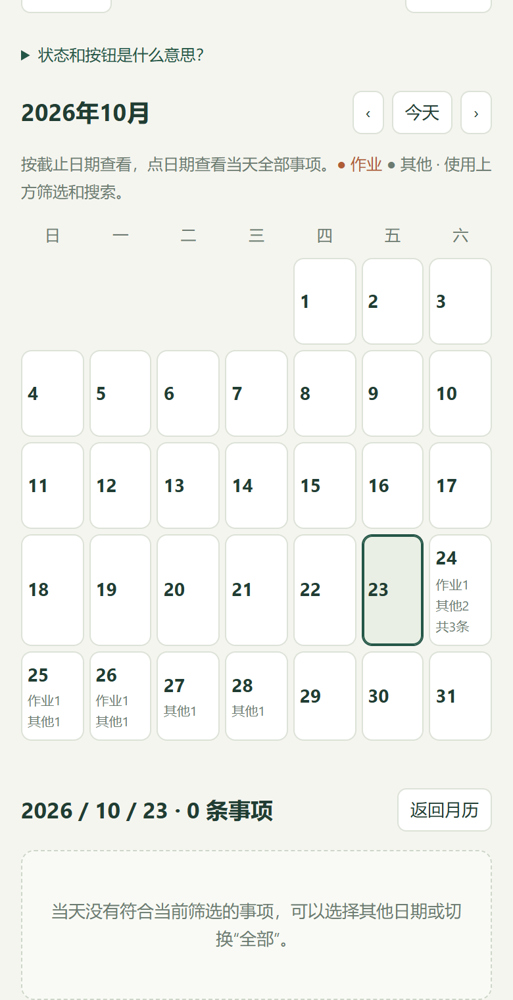

# 群务台 · 个人改进版

把 QQ 群通知整理成作业、事项和日历。基于 [ExpertKT/notice-hub v1.0.0](https://github.com/ExpertKT/notice-hub/tree/v1.0.0) 的非官方个人 fork，保留 MIT 许可证及原作者版权声明。

[下载安装与视频](https://github.com/sssyldtkzm/notice-hub/releases) · [个人版说明](docs/PERSONAL.md) · [原版说明](docs/UPSTREAM-README-v1.0.0.md) · [许可证](LICENSE)

## 改进内容

- 作业优先展示；其他事项在电脑上多列、手机上双列排列，支持切换密度。
- 展示来源群名、消息发送时间和截止时间；校验时间冲突，信息不明时提示确认。
- 重复通知保留各条来源；确定相同的事件归并，疑似相同的放在一起供确认。
- 收藏、高光、完成与恢复；正文展开后可在底部收起。
- 改进公告、通知及活动名称提取，过滤时间字段与无关提醒。
- 月历点击日期可查看当天全部事项，长标题换行、正文可展开。
- 个人 Android 客户端使用同一网页看板，处理状态栏、刘海和键盘安全区域。
- iPhone 可使用网页版及 `/calendar.ics` 日历订阅；本仓库没有 iOS 原生安装包。



## 源码运行（Windows / Python 3.12+）

```powershell
git clone --branch personal-v1 https://github.com/sssyldtkzm/notice-hub.git
cd notice-hub
python -m venv .venv
.\.venv\Scripts\python.exe -m pip install -r requirements.txt
Copy-Item .env.example .env
.\.venv\Scripts\python.exe main.py doctor
.\.venv\Scripts\python.exe main.py run
```

打开 `http://127.0.0.1:8766`，使用自己部署生成的 token 访问。新版看板位于 `/`，原版管理台位于 `/console`，可在管理台配置 QQ 接入、订阅群和模型。具体配置见 [个人版说明](docs/PERSONAL.md) 及 [原版接入指南](docs/napcat-setup.md)。

电脑服务和 QQ 接入引擎需要保持运行。手机需能连接电脑：同一局域网，或自行配置 Tailscale 等网络通道。下载 APK 不会自动连接其他人的服务。

## 开发与构建

```powershell
.\.venv\Scripts\python.exe -m pip install -r requirements-dev.txt
.\.venv\Scripts\python.exe -m pytest -q
```

[Android 构建](android-personal/README.md) · [Windows 打包](docs/PERSONAL.md#构建-windows-服务) · [视频制作](docs/demo/README.md)

## 来源与许可

基线为 v1.0.0 提交 `b5bafbcf6ee684d44ba494d5d3f70adbcf20b2f0`，该版本采用 MIT。此分支不包含作者后续 `main` 分支的新功能移植；后续版本的许可应单独核对。详见 [NOTICE-PERSONAL.md](NOTICE-PERSONAL.md)。本项目与原作者、腾讯没有官方关联。
